# 图片索引 — 烯烃复分解反应（研讨主题 2）

共 23 张图，与 `图片/` 下文件一一对应（450 dpi，已裁去图注与页眉，分面图已拆分）。
全部取自本主题「主要参考文献」所列文献的原文 PDF。

## P1 · N. Calderon, *Acc. Chem. Res.* **1972**, 5, 127-132.

| 序号 | 图号 | 图片 | 页码 | 章节 | 图题 | 备注（用法） |
|---|---|---|---|---|---|---|
| 1 | Figure 1 | 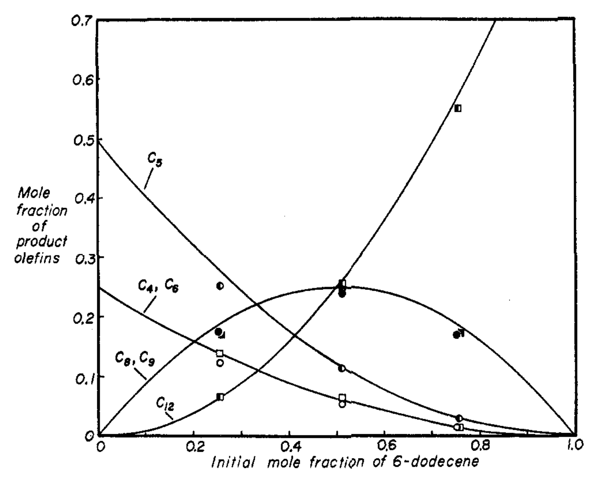 | 129 | Random Distribution of Alkylidene Groups | 2-戊烯与 6-十二烯复分解：产物分布符合纯随机重排 | 封面后的第一张定量证据：实线是理想随机分布，点是实测值。讲“复分解 = 碎片随机组合”，关掉交换机制。 |
| 2 | Figure 2 | 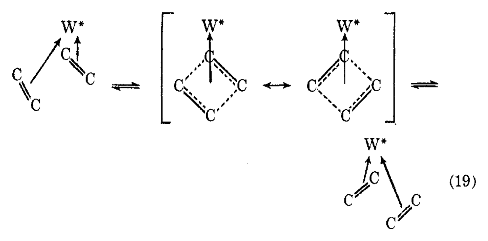 | 130 | The Transalkylidenation Step | 金属配体 SA/AS 电子重定位，使“准环丁烷”过渡态在轨道对称性上被允许 | 讲“为什么当时只能想到四元环”：四中心过渡态不是真环丁烷。一张图替代一段轨道对称性论证。 |
| 3 | Figure 3 | 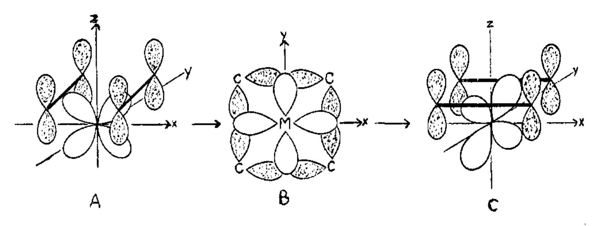 | 131 | The Transalkylidenation Step | 四亚甲基-金属过渡态（A→B→C） | 与 F2 二选一；建议 F2 主用，F3 用于回答“那键是怎么断的”。 |
| 4 | Figure 4 | 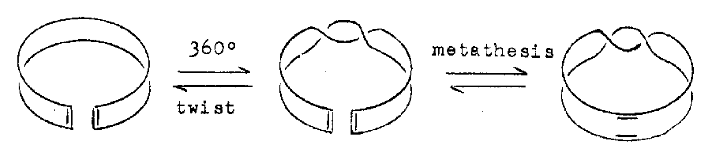 | 132 | Macrocyclics and Catenanes | 索烃的生成：环形链经 360° 扭转与复分解缝合 | 讲“早期只当工业反应太可惜”的注脚；可作备讲页，呼应高分子主题。 |

## P2 · T. M. Trnka, R. H. Grubbs, *Acc. Chem. Res.* **2001**, 34, 18-29.

| 序号 | 图号 | 图片 | 页码 | 章节 | 图题 | 备注（用法） |
|---|---|---|---|---|---|---|
| 5 | Figure 2 | 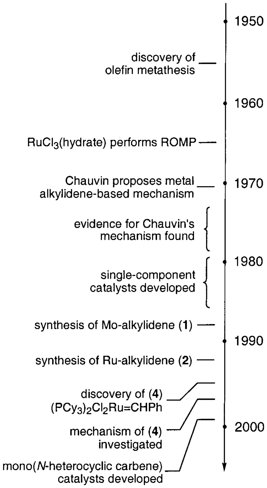 | 19 | Background | 里程碑时间线：1956–2003 催化剂与机理的关键节点 | 全篇叙事骨架，用一页把 2005 诺奖前的五十年串起来。讲到哪一步就指哪一行。 |
| 6 | Figure 3 | 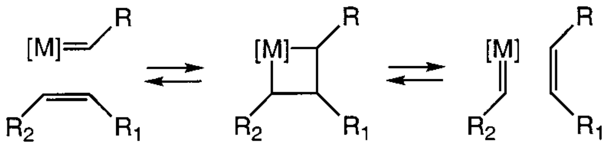 | 19 | Background | Chauvin 提出的金属亚烷基（卡宾）+ 金属杂环丁烷机理 | 机理页的核心图；与 P3_F12 配合：这张给“结论”，P3_F12 给“为什么”。 |
| 7 | Figure 6 | 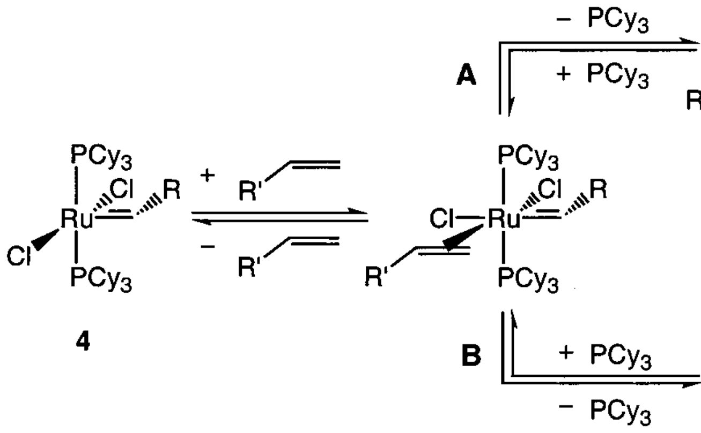 | 24 | Mechanistic Studies | Grubbs 催化剂的引发机理：膦解离型（A）与亚烷基/膦结合型 4 两条路 | 解释“Ⅱ 代为什么更强却被苯乙烯卡住”：Hoveyda 型靠 O→Ru 解离引发。 |

## P3 · Y. Chauvin, *Angew. Chem. Int. Ed.* **2006**, 45, 3740-3747（诺奖讲座）.

| 序号 | 图号 | 图片 | 页码 | 章节 | 图题 | 备注（用法） |
|---|---|---|---|---|---|---|
| 8 | Figure 8 | 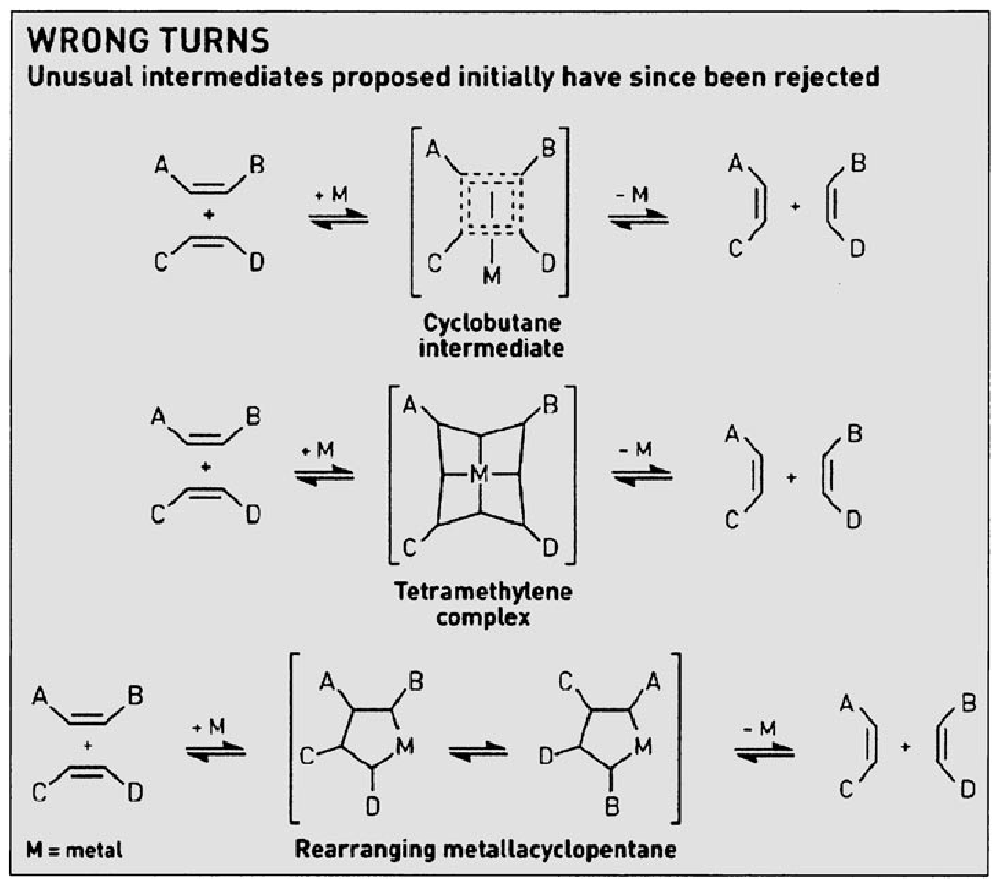 | 3744 | Olefin Metathesis: Discovery and First Achievements | 初期的“错误转向”：环丁烷、四亚甲基、重排金属杂环戊烷中间体（后被否定） | 讲“四条路只有一条活下来”：三个被否定的中间体并列，比一段文字有力。 |
| 9 | Figure 12 | 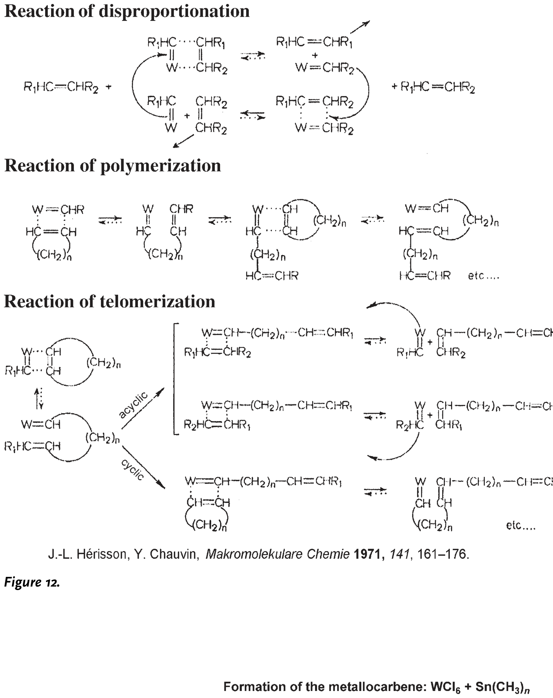 | 3746 | Olefin Metathesis: Discovery and First Achievements | 一个卡宾机理统一三类反应：歧化、开环聚合、调聚 | Chauvin 自己的示意（中性版机理），配色干净，适合投影；F8 与它相邻放。 |

## P4 · A. H. Hoveyda, A. R. Zhugralin, *Nature* **2007**, 450, 243-251.

| 序号 | 图号 | 图片 | 页码 | 章节 | 图题 | 备注（用法） |
|---|---|---|---|---|---|---|
| 10 | Figure 1 | 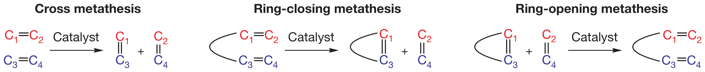 | 243 | Olefin metathesis and its importance | 三类复分解的通用图式：交叉（CM）、关环（RCM）、开环/交叉（ROCM 型） | 全篇第 2 页的“地图”：C1=C2 与 C3=C4 两个片段三种重新分配。宽幅图，用 fig_wide。 |
| 11 | Figure 2 (top) | 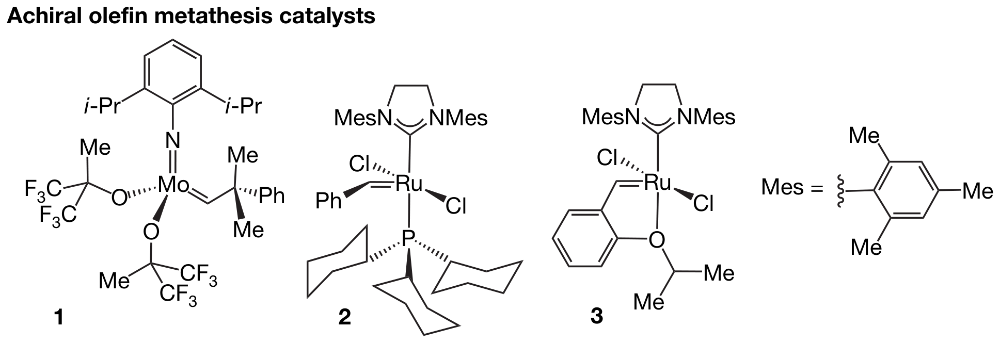 | 244 | Catalysts that make it possible | 无手性代表性催化剂：Mo 1、Ru 2（Grubbs I 型）、Ru 3（Hoveyda 型） | 页：前后周期对照——Mo 1 与 Ru 2/3 同框；Mes = 米基（mesityl）也在此定义。 |
| 12 | Figure 2 (bottom) | 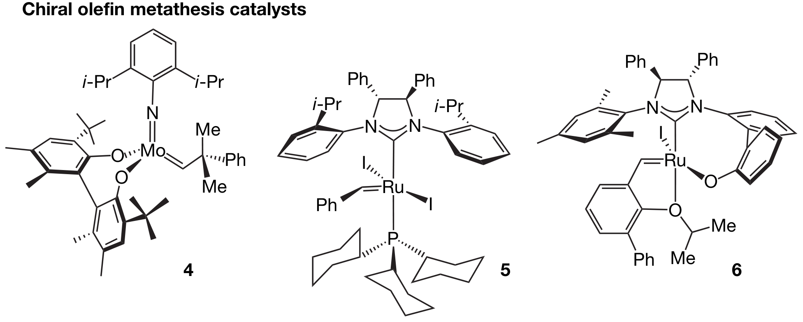 | 244 | Catalysts that make it possible | 手性代表性催化剂：手性 Mo 4、手性 Ru 5、受限构象 Ru 6 | 页：立体选择性——手性配体把“哪个烯烃先反应”变成选择性工具。 |
| 13 | Figure 3A | 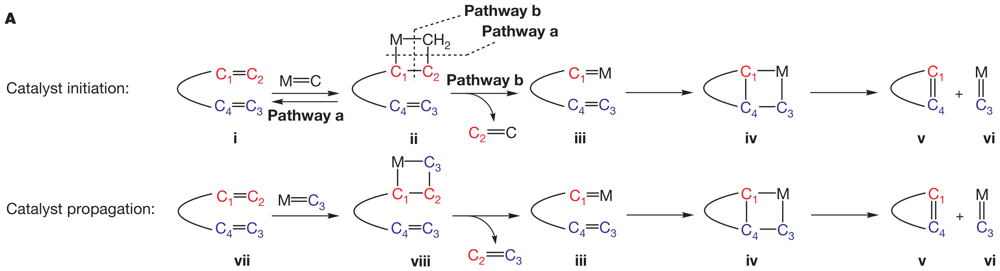 | 245 | Catalytic ring-closing metathesis | 关环复分解的通式机理：引发期 + 增长期，pathway a/b | 机理主场。讲清 pathway b：环内第二个 C=C 被裂解，这才是关环而非交叉。 |
| 14 | Figure 3B | 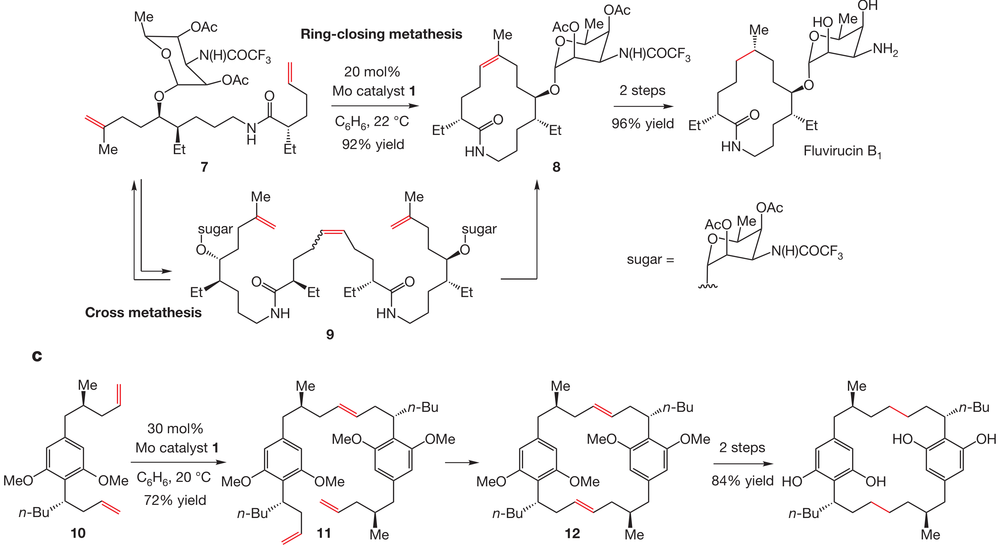 | 245 | Catalytic ring-closing metathesis | 关环复分解合成天然产物：黄曲霉毒素 fl uvirucin B1（92%）与 cylindrocyclophane F（72%） | 证明“反应有用”：一步关 14 元环。可与 P4_F8 合并成“应用”页。 |
| 15 | Figure 8 | 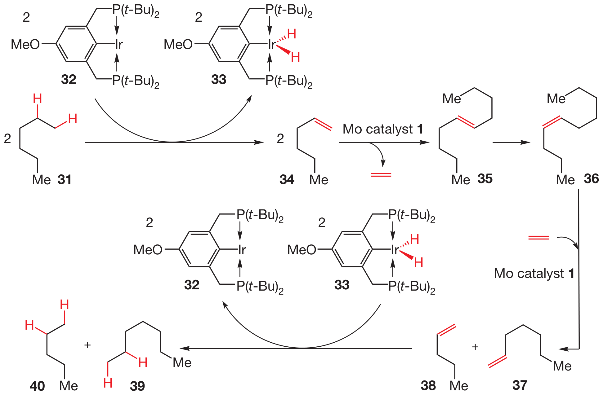 | 248 | Catalytic olefin metathesis and a better quality of life | 工业级应用：BILN 2061（丙型肝炎药物）核心环 400 kg 规模，83%，>99% 顺式 | “学术反应 → 工业资产”的最强证据；讲选择性（>99% cis）与放大。 |

## P5 · R. H. Grubbs, *Angew. Chem. Int. Ed.* **2006**, 45, 3760-3765（诺奖讲座）.

| 序号 | 图号 | 图片 | 页码 | 章节 | 图题 | 备注（用法） |
|---|---|---|---|---|---|---|
| 16 | Figure 2 | 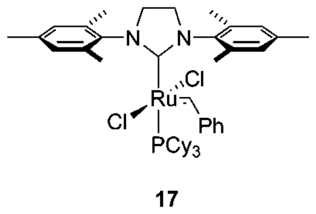 | 3763 | 第二章 | 第二代商品化催化剂（Grubbs II，7）：一个 PCy3 换成 NHC | “换一个配体 = 换一代催化剂”的视觉证据；配合 P6_F2 讲 H2IMes。 |
| 17 | Scheme 7 | 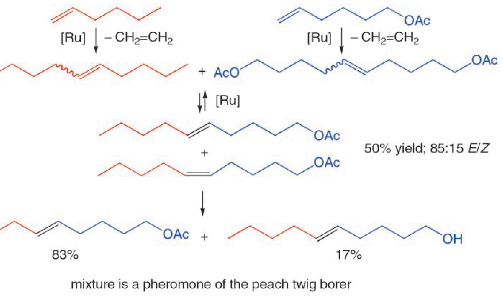 | 3764 | 第二章 | 无溶剂交叉复分解制备“绿色”化合物：1-己烯 + 乙酸己烯酯 | 讲交叉复分解为什么难：50% 收率、85:15 E/Z——同源二聚竞争。 |

## P6 · C. Samojłowicz, M. Bieniek, K. Grela, *Chem. Rev.* **2009**, 109, 3708-3742.

| 序号 | 图号 | 图片 | 页码 | 章节 | 图题 | 备注（用法） |
|---|---|---|---|---|---|---|
| 18 | Scheme 3 | 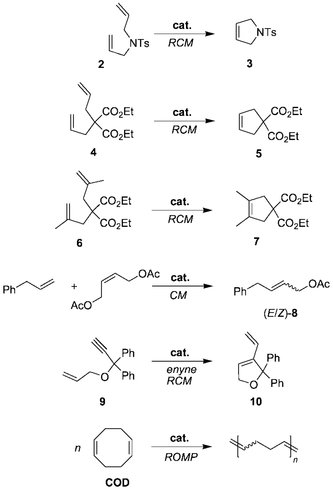 | 3710 | 2. Early Ruthenium Alkylidene Complexes | 复分解的基准反应：RCM / CM / 烯炔 RCM / ROMOP / ROMP | 一页建立“五类反应”的共同语法；备讲页，时间紧可跳过。 |
| 19 | Scheme 4 | 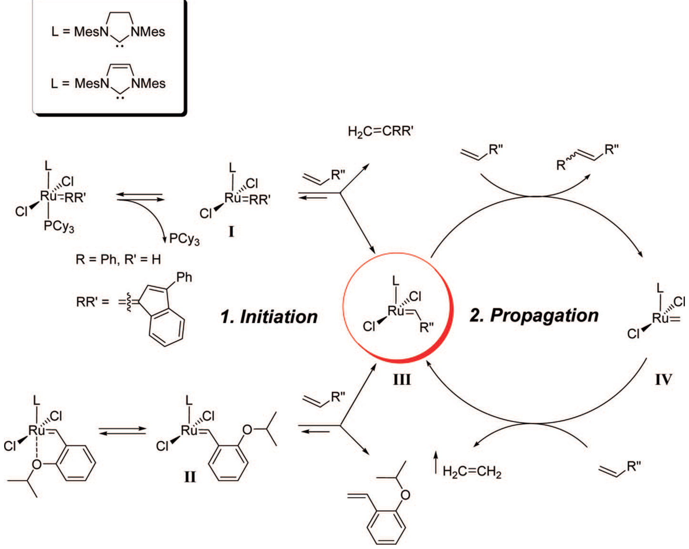 | 3711 | 3. Modern Ruthenium Alkylidene Complexes | 含 Ru 预催化剂的完整催化循环：引发（两条路）+ 增长 | 机理页首选：同一张图同框给出引发与增长，箭头清楚。 |
| 20 | Figure 2 | 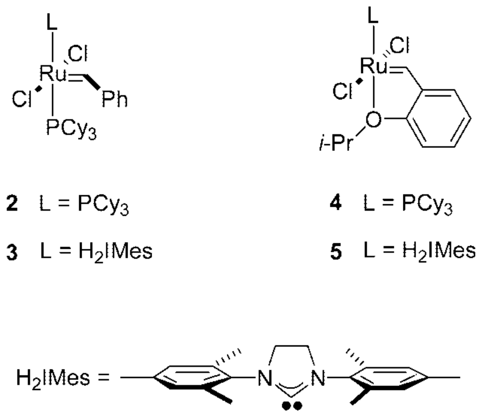 | 3711 | 3. Modern Ruthenium Alkylidene Complexes | 首批只含一个 NHC 的催化剂（15 Fürstner–Herrmann，16 Nolan–Grubbs，17 Grubbs） | “NHC 时代”起点；与 P5_F2 合看：7/17 即 Grubbs II 的结构式。 |

## P7 · G. C. Vougioukalakis, R. H. Grubbs, *Chem. Rev.* **2010**, 110, 1746-1787.

| 序号 | 图号 | 图片 | 页码 | 章节 | 图题 | 备注（用法） |
|---|---|---|---|---|---|---|
| 21 | Figure 1 | 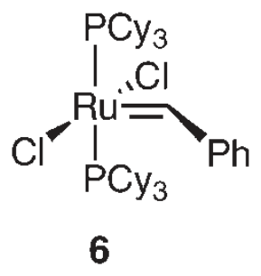 | 3763 | 第二章（Grubbs 诺奖讲座） | 第一代商品化催化剂 Grubbs I（6）：RuCl2(=CHPh)(PCy3)2 的原图 | “一代/二代同框”的左半边；与 P7_F2 成对使用。 |
| 22 | Figure 2 | 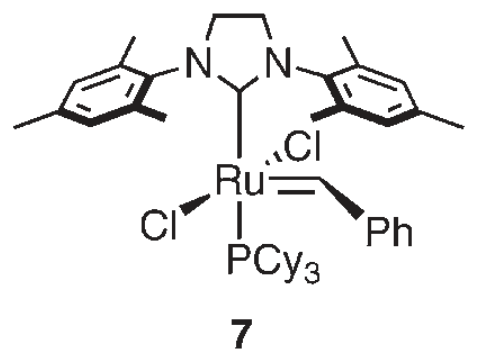 | 1748 | 2. Introduction to the Use of HCs | 一代（2/4）与二代（3/5）Ru 催化剂；H2IMes 的结构 | 把“一代/二代 = 同一骨架换一个配体”讲成一句话；H2IMes 定义放在这里。 |
| 23 | Scheme 1 | 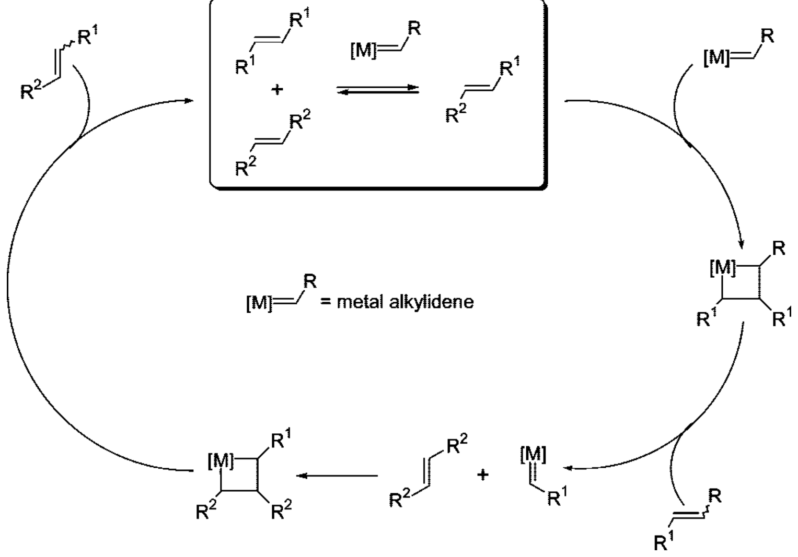 | 1747 | 1. Brief Introduction to Olefin Metathesis | 复分解的催化循环（金属亚烷基 + 金属杂环丁烷） | 机理备选图；与 P6_S4 同源，选一张即可。 |

